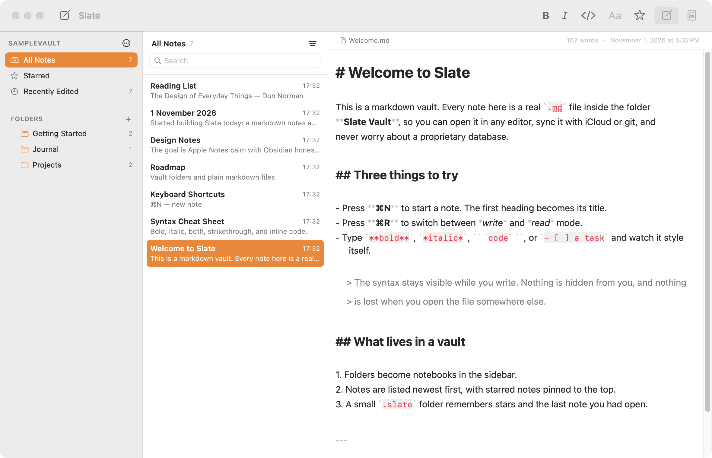
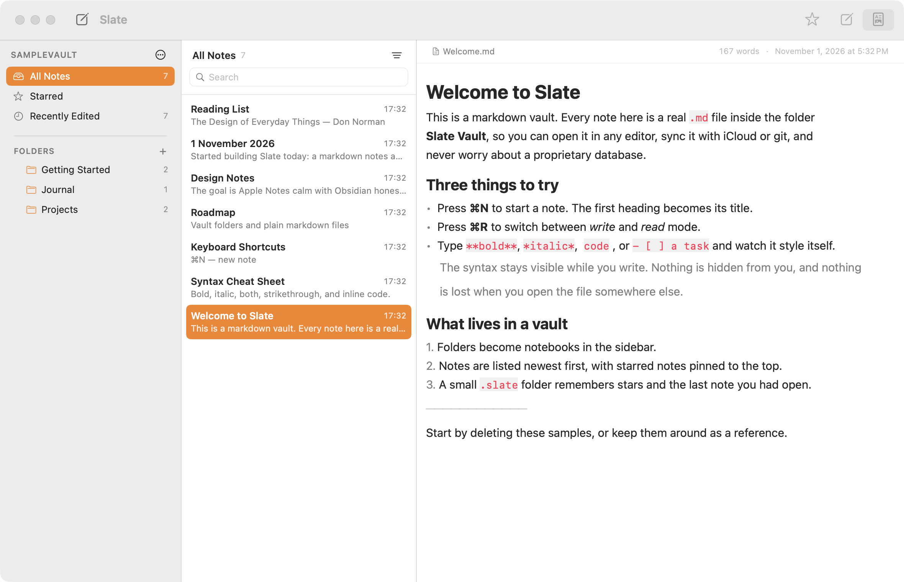

# Slate

Native macOS markdown notes — the calm three-pane feel of Apple Notes, the plain-folder honesty of Obsidian.

[](https://github.com/ericyng/slate/actions/workflows/ci.yml)



Every note is a real `.md` file in a folder you choose. Folders are notebooks. There is no database, so the vault opens in any editor, syncs with iCloud or git, and outlives the app.

## Quick start

```bash
cd Slate
./build.sh --run        # build Slate.app and launch it
```

Then press **Choose Vault…** and pick any folder (or **Create Sample Vault** to get a populated one). Read the [user guide](docs/USER_GUIDE.md) for the full tour.

## Docs

| Document | What it covers |
| --- | --- |
| [docs/USER_GUIDE.md](docs/USER_GUIDE.md) | Every feature, shortcut and workflow, plus troubleshooting |
| [docs/BUILDING.md](docs/BUILDING.md) | Building, running, testing, packaging, icons, signing, Xcode |
| [docs/ARCHITECTURE.md](docs/ARCHITECTURE.md) | Code map, data flow, markdown pipeline, extension points |
| [docs/UI_REDESIGN.md](docs/UI_REDESIGN.md) | Performance baseline and the plan for native chrome and Liquid Glass |
| [PLAN.md](PLAN.md) | How it was planned and what is done / next |

## Features

- **Vault = a folder.** `.md`, `.markdown`, `.mdown` and `.txt` files become notes; subfolders become notebooks.
- **Three panes.** Smart lists (All / Starred / Recently Edited), a folder tree with a **Vault Root** row for loose root-level notes, expand-all / collapse-all buttons, → note list with snippets and dates → editor.
- **Live markdown editing.** Headings, bold, italic, strikethrough, inline code, fenced blocks, quotes, lists, tasks and tables are styled as you type. In Live preview the markers are hidden and each paragraph reveals its raw source under the caret, so the file on disk stays exactly what you wrote.
- **Four layouts.** Live preview (`⌘2`, the default), source (`⌘1`), side by side (`⌘3`) or rendered reading (`⌘4`); `⌘R` toggles reading. The preview follows your typing.
- **One window per vault.** Keep several vaults open side by side; opening a vault that is already open raises its window instead of duplicating it.
- **Settings** (`⌘,`) with General, Appearance and Advanced tabs: theme, font size, text-column width, default layout, autosave delay, auto-rename, external-change watching, spell check, word count.
- **Autosave** (400 ms debounce, atomic writes) and a new note renames itself from its first `# heading`, like Apple Notes.
- **Search** across titles, filenames and full text, scoped to the current folder.
- **Find** (`⌘F`) inside the open note, with `⌘G` / `⇧⌘G` to step through matches.
- **Stars**, pinned to the top of every list, stored per vault.
- **External edits** picked up live via FSEvents without clobbering the note you are typing in.
- **Deletes go to the Trash**, never into the void.



## Requirements

macOS 14 or newer, and Xcode 15+ command line tools (developed against macOS 26 / Xcode 27 / Swift 6.4).

## Layout

```
Slate/
├── build.sh                 build → Slate.app
├── Package.swift            SwiftPM manifest (app + tests)
├── Sources/Slate/           app sources
├── Tests/SlateTests/        parser / renderer tests
├── Tools/make-icon.swift    icon generator
├── Resources/Info.plist     bundle metadata
├── SampleVault/             a vault to try it with
└── docs/                    this documentation
```

## Status

Working and in daily-shape for a first version. Not built yet: `[[wikilinks]]` and backlinks, a tags browser, images/attachments, drag-to-move notes, PDF/HTML export. See [PLAN.md](PLAN.md).
